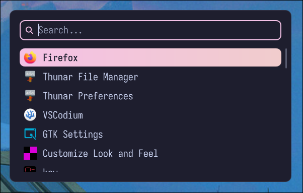

# rosemenu
A wofi-alternative that looks cool already.


## requirements

- **linux + wayland** — rosemenu is intended for wayland desktops.
- **[quickshell](https://github.com/quickshell-mirror/quickshell)** — required to run the bar.
- **a compatible wayland compositor** — workspace and window-title features depend on compositor support. (MangoWM used for testing)
- **coreutils** — used by the installer for file operations.

some modules may require additional system utilities or services, depending on how they are implemented. make sure any tools used by your configuration are installed and available in your `PATH`.

## installation

clone the repository and run the installer:

```bash
git clone https://github.com/sappyware/rosemenu.git
cd rosemenu
chmod +x install.sh
./install.sh
```

the installer copies the QML files into `~/.config/quickshell/rosemenu

## running

start rosemenu with:

```bash
qs -c rosemenu
```

to stop it, use:

```bash
qs -c rosemenu kill
```
example usage in MangoWM:
```bash
exec_once=qs -c rosemenu
```

## configuration
config file is located at ```~/.config/rosebar/config.toml```
```bash
# catppuccin-mocha | catppuccin-latte | nord | gruvbox | tokyonight | rose-pine | dracula
theme = "catppuccin-mocha"

[window]
width = 560            # px (200-4000)
radius = 12            # corner radius (0-200)
padding = 20           # inner padding (0-200)
gap = 16               # space between search and list (0-200)
border_width = 1
opacity = 0.97         # 0-1
dim = 0.0              # background dim, 0-1
offset_y = 0           # vertical offset from center
monitor = ""           # monitor name, "" = default

[search]
height = 40            # px (16-200)
radius = 10
border_width = 2
padding_x = 12
placeholder = "Search..."
icon = "\uf002"        # Nerd Font glyph
icon_size = 16

[list]
visible_rows = 6.5     # rows shown before scrolling (1-30)
row_height = 36        # px (16-200)
row_gap = 2            # (0-50)
row_radius = 10
padding_x = 8
icon_size = 26         # (8-128)
icon_gap = 12
show_icons = true
show_description = false
shrink_to_fit = true   # shrink list when fewer results
scrollbar = true
scrollbar_gap = 8
empty_text = "No results"

[font]
family = ""            # "" = system default
size = 15              # (6-80)
weight = "normal"      # thin|extralight|light|normal|regular|medium|semibold|demibold|bold|extrabold|black, or 1-1000
selected_weight = "normal"
italic = false
letter_spacing = 0

[behavior]
mode = "oneshot"       # "oneshot" or "daemon"
terminal = "foot"      # terminal for terminal apps
terminal_exec_flag = "-e"
remember_usage = true  # rank frequently used apps higher
max_results = 200      # (1-5000)
command_prefix = ">"   # prefix to run a raw command
close_on_click_outside = true
wrap = true            # wrap selection at list ends
hover_select = true    # mouse hover selects row

[animation]
enabled = true
duration_ms = 120      # (0-2000)
resize_ms = 180        # (0-2000)

# Overrides for the chosen theme. "" = use theme value.
# Format: "#rgb", "#rgba", "#rrggbb", "#rrggbbaa" or a color name.
[colors]
bg = ""
surface = ""
border = ""
fg = ""
muted = ""
accent = ""
selected_from = ""     # selection gradient start
selected_to = ""       # selection gradient end
selected_fg = ""
hover = ""
urgent = ""

```

## help me fix any bugs with PRs!
